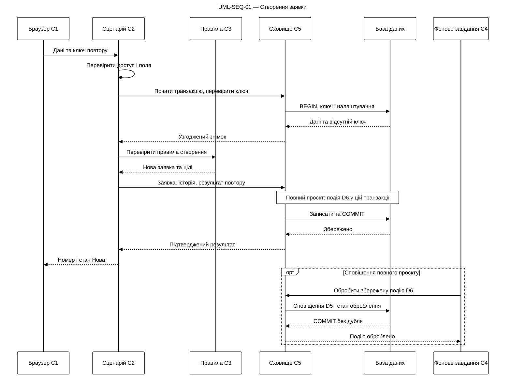

# Джерело UML-SEQ-01

Актуальні сценарії створено через Drawio MCP; редаговані фігури й повідомлення збережено в uml-sequence.drawio та coursework-diagrams.drawio.

## uml-sequence-main



## uml-sequence-errors

```mermaid
---
config:
  theme: base
  themeVariables:
    primaryColor: "#ffffff"
    primaryBorderColor: "#000000"
    primaryTextColor: "#000000"
    lineColor: "#000000"
    actorBkg: "#ffffff"
    actorBorder: "#000000"
    actorTextColor: "#000000"
    noteBkgColor: "#ffffff"
    noteBorderColor: "#000000"
    signalColor: "#000000"
title: UML-SEQ-01 — Повтори та відмови
---
sequenceDiagram
    participant B as Браузер C1
    participant A as Сценарій C2
    participant R as Сховище C5
    participant DB as База даних
    B->>A: Команда і ключ повтору
    alt Немає доступу або некоректні поля
        A-->>B: Відмова без бізнес-запису
    else Доступ і поля коректні
        A->>R: Перевірити ключ у транзакції
        R->>DB: Дані попередньої операції
        DB-->>R: Результат перевірки
        alt Ключ і вміст збігаються
            R-->>A: Попередній результат
            A-->>B: Та сама заявка після перевірки доступу
        else Ключ збігається, вміст інший
            R-->>A: Конфлікт повтору
            A-->>B: Конфлікт без зміни заявки
        else Нова операція
            A->>R: Зберегти заявку та історію
            R->>DB: Атомарний запис
            alt Помилка до COMMIT
                DB-->>R: ROLLBACK
                R-->>A: Зміну не підтверджено
                A-->>B: Помилка без часткового запису
            else COMMIT успішний
                DB-->>R: Збережено
                R-->>A: Номер заявки
                A--xB: Відповідь втрачено
                Note over B,DB: Повторити той самий ключ; не створювати нову заявку
            end
        end
    end
    Note over R,DB: Конкурентні повтори узгоджує унікальний ключ операції
```

